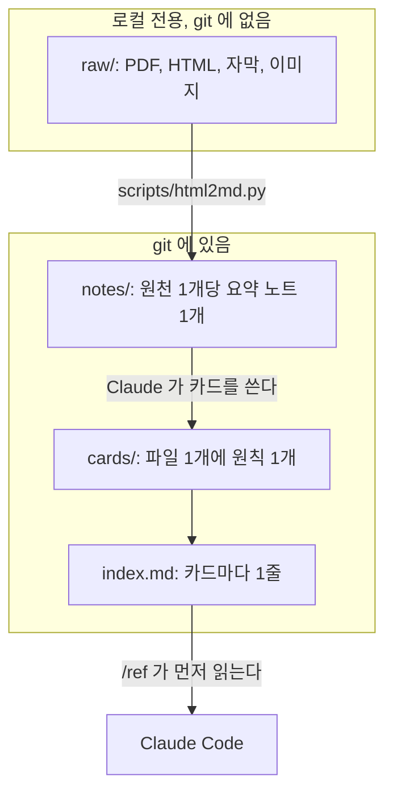
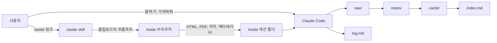
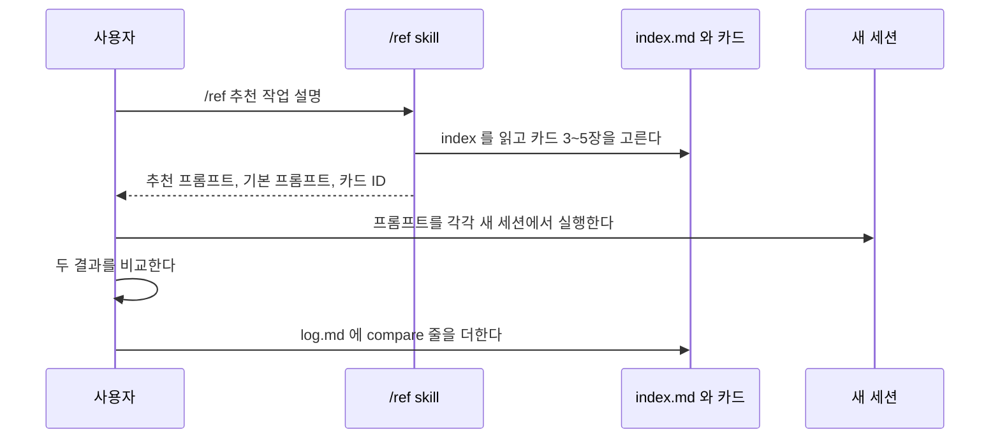
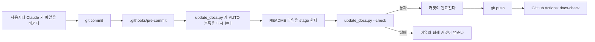

# AI 레퍼런스 라이브러리

[English](README.md) | **한국어**

이 저장소는 Claude 와 다른 AI 모델에게 일을 맡기는 방법을 모은 개인 라이브러리다. 이 라이브러리는 영상과 글의 요약을 작은 카드로 바꾼다. 카드 1장에는 원칙 1개와 유통기한이 들어 있다. 사용자가 작업을 시작하면, Claude 가 맞는 카드를 찾아 프롬프트를 추천한다. Claude 는 카드를 쓰지 않은 기본 프롬프트도 항상 함께 낸다. 그래서 사용자는 카드가 아직 도움이 되는지 확인할 수 있다.

<!-- AUTO:stats -->
| 원천 | 카드 | skill | 마지막 가져오기 |
|---|---|---|---|
| 2 | 25 (맡기는 방식 5, 검증과 리뷰 4, 컨텍스트, skill, 작업 이어 가기 4, HR 업무 자동화 사례 4, 답변 포맷 8) | 2 | 2026-10-29 |
<!-- /AUTO:stats -->

## 이 프로젝트가 필요한 이유

AI 모델과 일하는 방법에 대한 조언은 빨리 바뀐다. Claude Code 를 만든 Boris Cherny 는 2026년 1월에 plan mode 로 시작하라고 권했다. 2026년 6월에 Boris 는 새 모델에는 계획 단계가 거의 필요 없다고 말했다. Anthropic 의 Felix Rieseberg 는 좋은 skill 의 유효 기간이 짧다고 말했다. skill 에는 이전 세대 모델에 맞춘 지시가 들어 있기 때문이다.

PDF 를 모아 둔 폴더는 이 문제를 풀지 못한다. 사용자는 PDF 폴더를 빨리 검색할 수 없다. 어떤 조언이 낡았는지도 알 수 없다. 이 프로젝트는 3가지 문제를 푼다.

1. 사용자는 작업에 맞는 레퍼런스를 1분 안에 찾는다.
2. Claude 가 레퍼런스를 사용자의 작업에 맞는 프롬프트로 바꾼다.
3. 라이브러리가 낡은 조언을 스스로 표시한다.

## 설계

전체 설계는 [DESIGN.md](DESIGN.md) 에 있다. 이 절은 그 내용을 요약한다.

### 원칙

- **원천을 지킨다.** 요약은 다시 만들 수 있다. 원천을 잃으면 다시 만들 수도 검증할 수도 없다.
- **카드는 작게 만든다.** 카드 1장에 원칙 1개만 담는다. Claude 는 필요한 카드만 읽는다.
- **모든 카드에 유통기한을 붙인다.** 카드마다 `half_life` 와 `review_by` 필드가 있다.
- **카드를 모델에게 강요하지 않는다.** 추천 프롬프트에 카드 원문을 붙이지 않는다. 낡은 지시가 새 모델을 방해할 수 있기 때문이다.
- **기본 프롬프트와 항상 비교한다.** 기본 프롬프트가 같거나 나으면, 그 카드를 재검토한다.
- **세션 밖에서 채점한다.** 별도 세션이 결과를 검증한다. 결과를 만든 세션은 스스로 채점하지 않는다.
- **필요할 때만 기능을 더한다.** 검색 서버, plugin, 자동화는 실제 필요가 생길 때 더한다.

### /ref 의 두 가지 일

`/ref` skill 은 두 가지 일을 한다. Felix 는 고정된 역할과 낡은 skill 이 범용 모델을 제한한다고 경고했다. 두 일은 이 경고에 해당하는 정도가 다르다.

| 일 | 하는 일 | 위험 |
|---|---|---|
| 찾기 | 사용자에게 카드와 원문 링크를 보여 준다. | 낮다. 독자가 사람이다. 카드 원문이 작업 세션에 들어가지 않는다. |
| 추천 | 카드를 근거로 프롬프트를 쓴다. | 중간이다. 프롬프트가 작업 모델에게 간다. 낡은 카드가 낡은 지시를 전할 수 있다. |

추천은 아래 4가지 규칙을 따른다.

1. 프롬프트에 "너는 전문가야" 같은 역할 문장을 넣지 않는다.
2. 프롬프트에는 목표, 이유, 원천 데이터 위치, 검증 방법만 넣는다.
3. Claude 는 기본 프롬프트를 항상 함께 쓴다.
4. 사용자는 두 프롬프트를 각각 새 세션에서 실행한다.

### git 에 넣는 것

git 에는 텍스트만 넣는다. 요약 노트 2개는 markdown 으로 약 60 KB 다. 같은 원천 2개의 원본 PDF, HTML, Word, 이미지, 자막 파일은 약 25 MB 다. 이 파일들은 로컬 `raw/` 폴더에 둔다. git 은 이 폴더를 무시한다.

## 작동 방식

### 구조

라이브러리는 3층으로 되어 있다. 이 구조는 Andrej Karpathy 의 "LLM wiki" 패턴을 따른다.



Claude 는 `index.md` 를 먼저 읽고 맞는 카드만 연다. 카드는 Claude 가 열기 전까지 컨텍스트를 쓰지 않는다. 원천 약 100개까지는 검색 서버 없이 이 index 로 충분하다.

### 가져오기 흐름

새 원천은 9단계를 거쳐 라이브러리에 들어간다. 사용자는 처음 3단계를 한다. Claude 가 나머지를 한다.



1. 사용자가 Claude Code 에 `/aside <링크>` 를 입력한다. Claude 가 Aside 요청 프롬프트를 만들고 클립보드에 복사한다.
2. 사용자가 프롬프트를 Aside 에 붙여 넣는다. Aside 가 영상을 요약하고 문서 ID 이름으로 파일을 저장한다.
3. 사용자가 Claude 에게 "가져와줘" 라고 말한다.
4. Claude 가 Aside 파일을 `raw/<slug>/` 로 복사한다.
5. Claude 가 `scripts/html2md.py` 로 HTML 을 요약 노트 초안으로 바꾼다.
6. Claude 가 링크 수와 이미지 수를 Aside 가 보고한 수와 비교한다.
7. Claude 가 요약 노트를 표준 형식으로 정리한다.
8. Claude 가 요약 노트에서 카드를 만들고 `index.md` 에 더한다.
9. Claude 가 `log.md` 에 `ingested` 줄을 더한다.

Aside 가 끝나면 파일을 바로 가져온다. Aside 에서 작업을 지우면, 그 세션 폴더도 함께 지워지기 때문이다.

### 추천 흐름



기본 프롬프트가 같거나 나으면, Claude 가 카드의 `status` 를 `needs-review` 로 바꾼다. 효과를 확인한 프롬프트는 `prompts/` 에 저장한다.

## 저장소 구조

<!-- AUTO:layout -->
| 경로 | 설명 |
|---|---|
| `README.md` | 프로젝트 안내서(영어). AUTO 블록은 자동 생성된다. |
| `README.ko.md` | 프로젝트 안내서(한국어). |
| `DESIGN.md` | 설계 문서. 모든 규칙의 원본이다. |
| `CLAUDE.md` | Claude 가 이 저장소의 모든 세션에서 따르는 규칙. |
| `index.md` | 카드마다 1줄. Claude 가 가장 먼저 읽는다. |
| `log.md` | 추가만 하는 작업 기록(requested, ingested, compare). |
| `notes/` | 표준 형식 요약 노트. 원천 1개당 1개. |
| `cards/` | 카드. 파일 1개에 원칙, 패턴, 프롬프트, 사례 중 1개. |
| `templates/` | /aside 가 쓰는 Aside 요청 템플릿. |
| `scripts/` | 변환 스크립트와 문서 자동화 스크립트. |
| `research/` | 설계의 근거가 된 딥리서치 노트와 보고서. |
| `.claude/` | Claude Code 프로젝트 skill(/ref, /aside). |
| `.githooks/` | git hook. pre-commit 이 문서를 다시 만들고 검사한다. |
| `.github/` | GitHub 에서 문서 검사를 실행하는 CI workflow. |
| `.gitignore` | raw/ 와 site/ 를 git 에서 제외한다. |
| `raw/` | 로컬 전용. 원본 PDF, HTML, 자막, 이미지. git 에 없다. |
| `site/` | 로컬 전용. 생성된 웹페이지(계획). git 에 없다. |
<!-- /AUTO:layout -->

## 설치

### 필요한 도구

| 도구 | 용도 | 필수 여부 |
|---|---|---|
| macOS | `/aside` 의 `pbcopy`, Aside 세션 경로 | 필수 |
| Git | 버전 관리와 문서 hook | 필수 |
| [Claude Code](https://code.claude.com) | `/ref`, `/aside`, 가져오기, 카드 작성 | 필수 |
| Python 3.11 이상 | `scripts/update_docs.py` | 필수 |
| [uv](https://docs.astral.sh/uv/) | `scripts/html2md.py` 와 그 패키지 | 필수 |
| [Aside](https://docs.aside.com) | 스크린샷이 있는 영상 요약 | 새 원천을 넣을 때 |
| [Obsidian](https://obsidian.md) | 이미지와 함께 노트와 카드 보기 | 선택 |

### 설치 절차

1. 저장소를 clone 한다.

   ```bash
   git clone git@github.com:LeeYoonSam/ai-reference.git ~/Documents/ai-reference
   cd ~/Documents/ai-reference
   ```

2. git hook 을 켠다. pre-commit hook 이 README 파일을 최신 상태로 유지한다.

   ```bash
   git config core.hooksPath .githooks
   ```

3. 문서와 라이브러리를 검사한다.

   ```bash
   python3 scripts/update_docs.py --check
   ```

4. 백업이 있으면 `raw/` 를 복원한다. `raw/` 가 없어도 노트의 글은 읽힌다. 이미지는 보이지 않는다.
5. 저장소 폴더에서 Claude Code 를 연다. Claude Code 가 `.claude/skills/` 에서 `/ref` 와 `/aside` skill 을 읽는다.

다른 경로로 clone 하면, `.claude/skills/ref/SKILL.md` 와 `.claude/skills/aside/SKILL.md` 의 루트 경로를 고친다. 두 skill 은 다른 저장소에서도 동작하도록 절대 경로를 쓴다.

### 다른 저장소에서 skill 쓰기

skill 은 먼저 이 저장소 안에 있다. 다른 저장소에서 작업하면서 `/ref` 를 쓰려면, skill 폴더를 개인 skill 폴더로 복사하거나 연결한다.

```bash
mkdir -p ~/.claude/skills
ln -s ~/Documents/ai-reference/.claude/skills/ref ~/.claude/skills/ref
```

symbolic link 방식은 아직 시험하지 않았다. 연결한 뒤 Claude Code 를 열고 skill 목록에 `/ref` 가 보이는지 확인한다.

## 사용법

### 카드 찾기

```text
/ref verification
/ref 검증
```

Claude 가 카드를 최대 5장 보여 준다. 카드마다 제목, 요약, 원문 링크, 재검토일이 나온다. `review_by` 가 지난 카드에는 "재검증 필요" 가 붙는다.

### 프롬프트 추천 받기

인자를 `추천` 으로 시작한다.

```text
/ref 추천 신규 입사자 3개월 내 퇴사 원인을 분석해서 피플팀 회의 자료를 만들고 싶다
```

Claude 는 3가지를 돌려준다.

1. 카드 3~5장으로 만든 추천 프롬프트
2. 카드를 쓰지 않은 기본 프롬프트
3. 사용한 카드의 ID

사용자는 두 프롬프트를 각각 새 세션에서 실행한다. 사용자는 결과를 비교한다. 그다음 `log.md` 에 1줄을 더한다. 예: `2026-11-02 compare | grade-outside-session | 추천 승`

### 새 영상이나 글 넣기

1. Claude Code 에 `/aside https://www.youtube.com/watch?v=<id>` 를 입력한다.
2. 클립보드의 프롬프트를 Aside 에 붙여 넣는다.
3. Aside 가 끝나면 Claude 에게 "가져와줘" 라고 말한다.
4. Claude 가 만든 노트와 카드를 검토한다.
5. Claude 에게 커밋을 요청한다.

라이브러리에 같은 문서 ID 가 있으면 `/aside` 는 멈춘다. 글 링크용 템플릿은 2단계 작업이다. 그 전까지는 스크린샷이 필요 없는 글을 Claude 가 직접 가져올 수 있다.

### 로컬에서 보기

| 보려는 것 | 방법 |
|---|---|
| Aside 원본 모양 | `raw/<slug>/original.html` 이나 `original.pdf` 를 연다. HTML 은 이미지를 안에 담은 단일 파일이다. |
| 라이브러리 전체 | 저장소 폴더를 Obsidian vault 로 연다. |
| 웹페이지 | 계획 단계다. `scripts/build_site.py` 가 `site/` 를 만들 예정이다. |

노트의 이미지는 `raw/` 를 가리키는 상대 경로를 쓴다. 이미지는 Obsidian 에서 보인다. GitHub 웹사이트에서는 보이지 않는다.

### 라이브러리를 최신으로 유지하기

1. 카드마다 `half_life` 와 `review_by` 가 있다. `short` 는 3개월이다. `medium` 과 `long` 은 12개월이다.
2. 새 모델이 나오면, `short` 카드를 카드 적용 프롬프트와 기본 프롬프트로 각각 실행한다. 기본 프롬프트가 같으면 카드를 폐기한다.
3. [DESIGN.md](DESIGN.md) 12절의 공식 피드를 구독한다. 예는 Claude Code 변경 이력, Claude Platform 릴리스 노트, Felix Rieseberg 블로그다.
4. 요약 채널은 새 자료를 발견하는 데만 쓴다. 카드는 원래 발언자나 원문을 인용한다.

## 카드 형식

모든 카드는 YAML frontmatter 가 있는 markdown 파일이다. 전체 형식은 [DESIGN.md](DESIGN.md) 9.2절에 있다.

```yaml
---
id: grade-outside-session
title: 만든 세션이 아니라 바깥에서 채점한다
type: principle          # principle, pattern, prompt, case, anti-pattern 중 1개
scope: agent-task        # agent-task, api-output, both 중 1개
tags: [verification, review]
source_note: notes/2026-10-26_agentos_delegate-to-claude.md
source_url: "https://www.youtube.com/watch?v=D-SVFneJ_Nk"
author: Felix Rieseberg (Anthropic)
tier: T1                 # T1 빌더, T2 실무자, T3 요약 채널
source_date: 2026-10-20
valid_as_of: 2026-10-29
model_context: Claude Opus 5.5, Claude Code v2.1
half_life: medium        # short, medium, long 중 1개
review_by: 2027-10-29
status: active           # active, needs-review, deprecated 중 1개
superseded_by:
---
```

본문에는 섹션이 최대 5개 있다. 원칙, 언제 쓰나, 프롬프트 문장, 근거, 지난 방식이다. 내용이 없는 섹션은 카드에서 뺀다.

## 문서 자동화

README 파일은 저장소의 내용으로 스스로 갱신된다. 사용자는 숫자, 표, 폴더 목록을 직접 고칠 필요가 없다.

### 자동으로 만드는 부분

`scripts/update_docs.py` 가 두 README 파일의 AUTO 블록 6개를 채운다.

| 블록 | 원본 |
|---|---|
| `stats` | 노트, 카드, skill 의 수와 `log.md` 의 마지막 `ingested` 날짜 |
| `layout` | 최상위 항목. 설명은 스크립트의 `LAYOUT` 표에서 가져온다. |
| `sources` | `notes/` 의 모든 파일의 frontmatter |
| `cards` | `cards/` 의 모든 파일의 frontmatter |
| `skills` | `.claude/skills/` 의 모든 `SKILL.md` 의 frontmatter |
| `scripts` | `scripts/` 의 모든 스크립트의 두 줄 docstring |

각 블록은 `<!-- AUTO:name -->` 과 `<!-- /AUTO:name -->` 사이에 있다. 표시 안쪽을 손으로 고치지 않는다. 다음 실행이 덮어쓰기 때문이다.

### 실행 시점



- **커밋할 때마다** pre-commit hook 이 AUTO 블록을 다시 만들고 README 파일을 stage 한다. 사용자가 손으로 고치고 stage 하지 않은 README 는 건너뛴다.
- **push 와 pull request 마다** `docs-check` workflow 가 GitHub 에서 같은 검사를 실행한다.

검사는 아래 경우에 실패한다.

1. AUTO 블록이 최신이 아니다.
2. `README.md` 와 `README.ko.md` 의 머리글 구조가 다르다. 이 검사가 번역 누락을 잡는다.
3. 최상위 파일이나 폴더에 `LAYOUT` 표의 설명이 없다.
4. 카드 파일이 `index.md` 에 없다. 또는 `index.md` 가 없는 파일을 가리킨다.
5. 스크립트 docstring 에 영어 첫 줄이나 한국어 둘째 줄이 없다.

### 손으로 쓰는 부분

이 절 같은 서술 부분은 사람이나 Claude 가 써야 한다. 커밋이 설계나 구현 파일을 바꾸고 README 파일을 바꾸지 않으면, hook 이 확인 알림을 출력한다. `CLAUDE.md` 는 Claude 에게 두 언어를 함께 고치라고 지시한다.

## 목록

이 절은 자동으로 만든다. 이 절은 항상 저장소와 일치한다.

### 원천

<!-- AUTO:sources -->
| 게시일 | 채널 | 제목 | 문서 ID | 카드 수 |
|---|---|---|---|---|
| 2026-10-26 | AgentOS | [클로드에게 일을 맡기는 법](notes/2026-10-26_agentos_delegate-to-claude.md) | `yt-gV0CtvIX5zk` | 12 |
| 2026-10-28 | 원티드 | [HR AI 에이전트 실무 레퍼런스](notes/2026-10-28_wanted_hr-ai-agent-ep03.md) | `yt-IrK71LslbFQ` | 5 |
<!-- /AUTO:sources -->

### 카드

<!-- AUTO:cards -->
**맡기는 방식**

| 제목 | 유형 | 반감기 | 재검토일 |
|---|---|---|---|
| [맡기기 전에 깊이 프롬프트의 4가지 질문을 먼저 묻는다](cards/delegation/deeper-not-bigger.md) | prompt | medium | 2027-10-29 |
| [작업을 하나씩 집어 주지 말고 목표로 맡긴다](cards/delegation/delegate-goal-not-task.md) | principle | medium | 2027-10-29 |
| [과제를 명사가 아니라 동사로 다시 정의하고 다른 분야의 방법을 끌어온다](cards/delegation/nouns-to-verbs.md) | pattern | medium | 2027-10-29 |
| [역할을 씌우면 말투만 바뀐다. 전문가의 방법과 도구를 쓰게 한다](cards/delegation/role-sentence-roleplay-trap.md) | anti-pattern | short | 2027-01-29 |
| [목표는 일부러 터무니없이 높게 잡고 해 볼 만하다고 말해 준다](cards/delegation/set-absurd-goal.md) | pattern | short | 2027-01-29 |

**검증과 리뷰**

| 제목 | 유형 | 반감기 | 재검토일 |
|---|---|---|---|
| [적대적 리뷰 여러 개를 돌리고 판사 Claude 가 타당한 비판만 거른다](cards/verification/adversarial-review-with-judge.md) | pattern | medium | 2027-10-29 |
| [팩트 체크는 1차 자료를 찾고 그 자료의 신뢰성까지 확인하게 한다](cards/verification/fact-check-primary-sources.md) | prompt | medium | 2027-10-29 |
| [만든 세션이 아니라 바깥에서 채점한다](cards/verification/grade-outside-session.md) | principle | medium | 2027-10-29 |
| [넘기기 불안하면 내 피드백과 Claude 의 피드백을 나란히 비교한다](cards/verification/side-by-side-with-claude.md) | pattern | medium | 2027-10-29 |

**컨텍스트, skill, 작업 이어 가기**

| 제목 | 유형 | 반감기 | 재검토일 |
|---|---|---|---|
| [작업 정리 문서와 다음 프롬프트로 세션을 이어 간다](cards/context/end-of-day-handoff-doc.md) | pattern | short | 2027-01-29 |
| [내가 준 피드백을 모아 규칙 목록으로 바꾸고 리뷰 입력으로 쓴다](cards/context/feedback-to-rules.md) | pattern | medium | 2027-10-29 |
| [골라 준 요약 대신 원본 데이터와 컴퓨터를 열어 준다](cards/context/open-raw-data-and-computer.md) | principle | medium | 2027-10-29 |
| [스킬은 금방 낡는다. 스킬 없는 기본 프롬프트와 비교한다](cards/context/skill-half-life-try-plain-prompt.md) | principle | short | 2027-01-29 |

**HR 업무 자동화 사례**

| 제목 | 유형 | 반감기 | 재검토일 |
|---|---|---|---|
| [조직 목표와 개인 이력을 함께 주고 목표 후보를 제안받는다](cards/hr-automation/context-based-goal-suggestion.md) | case | medium | 2027-10-29 |
| [설문 폼을 공감하고 이어 묻는 대화로 바꾼다](cards/hr-automation/conversational-survey.md) | case | medium | 2027-10-29 |
| [AI 가 전 건을 판정하고 사람은 확인 필요 건만 본다](cards/hr-automation/exception-based-review.md) | case | medium | 2027-10-29 |
| [원천 파일을 올리면 계산과 브리핑을 한 번에 받는다](cards/hr-automation/upload-then-briefing.md) | case | medium | 2027-10-29 |

**답변 포맷**

| 제목 | 유형 | 반감기 | 재검토일 |
|---|---|---|---|
| [에이전트 작업 보고는 결과 1~2문장으로 시작하고 요약을 반복하지 않는다](cards/format/agent-report-outcome-first.md) | pattern | medium | 2027-10-30 |
| [포맷 규칙을 더하기 전에 모델의 기본값을 먼저 확인한다](cards/format/check-model-default-before-format-rules.md) | pattern | short | 2027-01-30 |
| [포맷 규칙은 적을수록 지켜진다. 기본값에서 벗어나게 하는 규칙만 남긴다](cards/format/fewer-format-rules.md) | principle | long | 2027-10-30 |
| [결론을 첫 문장에 쓴다](cards/format/lead-with-outcome.md) | principle | long | 2027-10-30 |
| [목록은 내용이 다면적일 때만 쓴다. 관계와 논증은 산문으로 쓴다](cards/format/lists-only-when-multifaceted.md) | principle | medium | 2027-10-30 |
| [마크다운은 렌더링되는 채널에서만 쓴다](cards/format/markdown-only-when-rendered.md) | principle | long | 2027-10-30 |
| [포맷 지시는 금지형이 아니라 원하는 형태로 쓴다](cards/format/positive-format-instructions.md) | pattern | long | 2027-10-30 |
| [가독성이 간결함보다 앞선다. 짧게 쓰는 방법은 내용 선택이다](cards/format/readability-over-brevity.md) | principle | medium | 2027-10-30 |
<!-- /AUTO:cards -->

### skill

<!-- AUTO:skills -->
| skill | 사용법 | 파일 |
|---|---|---|
| `/aside` | `/aside <YouTube 또는 글 링크>` | [.claude/skills/aside/SKILL.md](.claude/skills/aside/SKILL.md) |
| `/ref` | `/ref [찾을 말] 또는 [추천 작업 설명]` | [.claude/skills/ref/SKILL.md](.claude/skills/ref/SKILL.md) |
<!-- /AUTO:skills -->

### 스크립트

<!-- AUTO:scripts -->
| 파일 | 용도 |
|---|---|
| [`scripts/html2md.py`](scripts/html2md.py) | Aside 원본 HTML 을 요약 노트 초안(markdown)과 이미지 파일로 바꾼다. |
| [`scripts/update_docs.py`](scripts/update_docs.py) | README.md 와 README.ko.md 의 AUTO 블록을 다시 만들고, 문서와 라이브러리의 정합성을 검사한다. |
<!-- /AUTO:scripts -->

## 로드맵

| 단계 | 작업 |
|---|---|
| 1단계, 완료 | 원천 폴더, 변환, 첫 카드, `/ref`, `/aside`, 문서 자동화 |
| 2단계, 2주 안 | `import_aside.py`, `build_site.py`, `freshness.py`, 글 템플릿, 피드 목록 |
| 3단계, 1~3개월 | GitHub Actions 일일 피드 수집, 예약 분류, `ingest-reference` skill |
| 필요할 때만 | 카드 수백 장 이후의 검색 서버, 팀 공유용 plugin, `raw/` 용 클라우드 드라이브 |

## 알려진 한계

- `half_life` 기간은 시작값이다. 아직 이 값을 뒷받침하는 데이터가 없다.
- Aside 가 요청한 파일 이름을 항상 따르는지 확인하지 않았다.
- Felix 카드의 타임스탬프는 AgentOS 정리 영상 기준이다. 원 인터뷰의 해당 시점은 아직 찾지 않았다.
- `raw/` 는 git 에 없다. Time Machine 이나 클라우드 드라이브로 백업한다.

## 참고 자료

- Felix Rieseberg, [How to be more ambitious: A tutorial for humans with models](https://felixrieseberg.com/how-to-be-more-ambitious-a-tutorial-for-humans-with-models/), 2026-10-13
- Andrej Karpathy, [LLM wiki](https://gist.github.com/karpathy/442a6bf555914893e9891c11519de94f)
- Anthropic, [Effective context engineering for AI agents](https://www.anthropic.com/engineering/effective-context-engineering-for-ai-agents)
- Anthropic, [Claude Code memory](https://code.claude.com/docs/en/memory), [features overview](https://code.claude.com/docs/en/features-overview)
- 이 설계의 근거 조사: [research/2026-10-29_지식베이스-설계/report.md](research/2026-10-29_지식베이스-설계/report.md)
