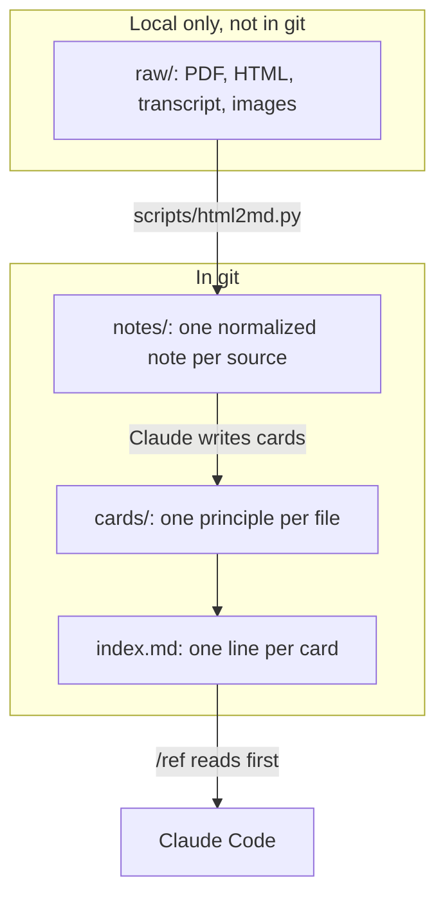
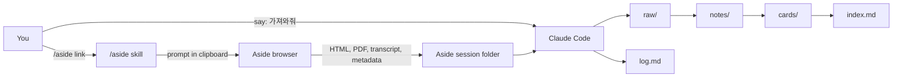
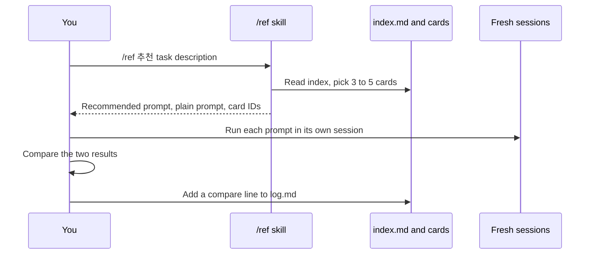
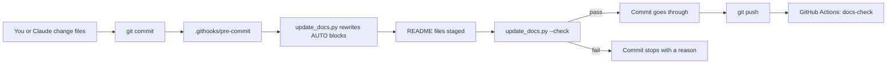

# AI Reference Library

**English** | [한국어](README.ko.md)

This repository is a personal library of methods for delegating work to Claude and other AI models. It turns video and article summaries into small cards. Each card holds one principle and an expiry date. When you start a task, Claude finds the matching cards and recommends a prompt. Claude always adds a plain prompt without cards, so you can see whether the cards still help.

<!-- AUTO:stats -->
| Sources | Cards | Skills | Last ingest |
|---|---|---|---|
| 2 | 17 (Delegation 5, Verification and review 4, Context, skills, handoff 4, HR automation cases 4) | 2 | 2026-10-29 |
<!-- /AUTO:stats -->

## Why this project exists

Advice about working with AI models changes fast. Boris Cherny, who created Claude Code, recommended starting in plan mode in January 2026. In June 2026 he said newer models rarely need a planning step. Felix Rieseberg of Anthropic said good skills have a short shelf life, because they carry instructions written for older models.

A folder of PDFs does not handle this well. You cannot search it quickly, and nothing tells you which advice is stale. This project solves three problems:

1. You find the right reference for a task in under a minute.
2. Claude turns references into a prompt for your task.
3. The library flags its own stale advice.

## Design

The full design is in [DESIGN.md](DESIGN.md). This section summarizes it.

### Principles

- **Keep the original sources.** A summary can be rebuilt. A lost source cannot be rebuilt or checked.
- **Keep cards small.** One card holds one principle. Claude reads only the cards it needs.
- **Give every card an expiry date.** Each card has `half_life` and `review_by` fields.
- **Do not force cards on the model.** A recommended prompt never pastes card text. Old instructions can hurt newer models.
- **Always compare with a plain prompt.** If the plain prompt does as well, the card goes back for review.
- **Grade outside the session.** A separate session checks the work. The session that made the work does not grade itself.
- **Add features only when needed.** Search servers, plugins, and automation come later, when a real need appears.

### Two jobs of /ref

The `/ref` skill does two jobs. Felix warned that fixed roles and stale skills limit a general model. The two jobs carry different risk.

| Job | What it does | Risk |
|---|---|---|
| Find | Shows cards and source links to you. | Low. The reader is a person. Card text does not enter the work session. |
| Recommend | Writes a prompt from cards. | Medium. The prompt goes to the work model. Stale cards can pass stale instructions. |

The recommend job follows four rules:

1. The prompt has no role sentence such as "You are an expert".
2. The prompt has only the goal, the reason, the location of the raw data, and the check method.
3. Claude always writes a plain prompt as well.
4. You run both prompts in fresh sessions.

### What goes into git

Git holds text only. Two summaries take about 60 KB as markdown. The original PDF, HTML, Word, image, and transcript files for the same two sources take about 25 MB. These files stay in the local `raw/` folder, which git ignores.

## How it works

### Architecture

The library has three layers. This structure follows Andrej Karpathy's "LLM wiki" pattern.



Claude reads `index.md` first and opens only the cards that match. A card costs no context until Claude opens it. Up to about 100 sources, this index works without a search server.

### Ingest flow

A new source enters the library in nine steps. You do the first three. Claude does the rest.



1. You type `/aside <link>` in Claude Code. Claude builds an Aside request prompt and copies it to the clipboard.
2. You paste the prompt into Aside. Aside summarizes the video and saves files named after the document ID.
3. You tell Claude "가져와줘", which means "bring it in".
4. Claude copies the Aside files into `raw/<slug>/`.
5. Claude converts the HTML into a draft note with `scripts/html2md.py`.
6. Claude compares the link and image counts with the counts that Aside reported.
7. Claude normalizes the note to the standard format.
8. Claude writes cards from the note and adds them to `index.md`.
9. Claude appends an `ingested` line to `log.md`.

Copy the files soon after Aside finishes. If you delete the task in Aside, its session folder goes with it.

### Recommend flow



If the plain prompt does as well or better, Claude sets the card `status` to `needs-review`. Prompts that worked go into `prompts/`.

## Repository layout

<!-- AUTO:layout -->
| Path | Description |
|---|---|
| `README.md` | Project guide (English). AUTO blocks are generated. |
| `README.ko.md` | Project guide (Korean). |
| `DESIGN.md` | Design document. The source of truth for all rules. |
| `CLAUDE.md` | Rules Claude follows in every session in this repository. |
| `index.md` | One line per card. Claude reads this first. |
| `log.md` | Append-only work log (requested, ingested, compare). |
| `notes/` | Normalized notes. One per source. |
| `cards/` | Cards. One principle, pattern, prompt, or case per file. |
| `templates/` | Aside request templates used by /aside. |
| `scripts/` | Conversion and documentation scripts. |
| `research/` | Deep-research notes and reports behind the design. |
| `.claude/` | Claude Code project skills (/ref, /aside). |
| `.githooks/` | Git hooks. pre-commit regenerates and checks the docs. |
| `.github/` | CI workflow that runs the docs check on GitHub. |
| `.gitignore` | Keeps raw/ and site/ out of git. |
| `raw/` | Local only. Original PDF, HTML, transcripts, images. Not in git. |
| `site/` | Local only. Generated web pages (planned). Not in git. |
<!-- /AUTO:layout -->

## Installation

### Requirements

| Tool | Needed for | Required |
|---|---|---|
| macOS | `pbcopy` in `/aside`, Aside session paths | Yes |
| Git | Version control and the docs hook | Yes |
| [Claude Code](https://code.claude.com) | `/ref`, `/aside`, ingest, card writing | Yes |
| Python 3.11 or later | `scripts/update_docs.py` | Yes |
| [uv](https://docs.astral.sh/uv/) | `scripts/html2md.py` and its packages | Yes |
| [Aside](https://docs.aside.com) | Video summaries with screenshots | For new sources |
| [Obsidian](https://obsidian.md) | Browsing notes and cards with images | No |

### Setup

1. Clone the repository.

   ```bash
   git clone git@github.com:LeeYoonSam/ai-reference.git ~/Documents/ai-reference
   cd ~/Documents/ai-reference
   ```

2. Turn on the git hooks. The pre-commit hook keeps the README files current.

   ```bash
   git config core.hooksPath .githooks
   ```

3. Check the docs and the library.

   ```bash
   python3 scripts/update_docs.py --check
   ```

4. Restore `raw/` if you have a backup. Notes still read correctly without it, but images do not show.
5. Open Claude Code in the repository folder. Claude Code loads the `/ref` and `/aside` skills from `.claude/skills/`.

If you clone to a different path, update the root path in `.claude/skills/ref/SKILL.md` and `.claude/skills/aside/SKILL.md`. Both skills use an absolute path so they also work from other repositories.

### Use the skills from other repositories

The skills live in this repository first. To use `/ref` while you work in another repository, copy or link the skill folder into your personal skills folder.

```bash
mkdir -p ~/.claude/skills
ln -s ~/Documents/ai-reference/.claude/skills/ref ~/.claude/skills/ref
```

The symbolic link approach is not yet tested. After you link it, open Claude Code and confirm that `/ref` appears in the skill list.

## Usage

### Find cards

```text
/ref verification
/ref 검증
```

Claude shows up to five cards with their titles, summaries, source links, and review dates. A card past its `review_by` date gets a "재검증 필요" tag, which means "needs re-check".

### Get a prompt recommendation

Start the argument with `추천`, which means "recommend".

```text
/ref 추천 신규 입사자 3개월 내 퇴사 원인을 분석해서 피플팀 회의 자료를 만들고 싶다
```

Claude returns three things:

1. A recommended prompt built from three to five cards.
2. A plain prompt without cards.
3. The IDs of the cards it used.

Run each prompt in a fresh session. Compare the results. Then add one line to `log.md`, for example `2026-11-02 compare | grade-outside-session | recommended won`.

### Add a new video or article

1. Type `/aside https://www.youtube.com/watch?v=<id>` in Claude Code.
2. Paste the prompt from your clipboard into Aside.
3. When Aside finishes, tell Claude "가져와줘".
4. Review the new note and cards that Claude made.
5. Ask Claude to commit them.

`/aside` stops if the library already has the same document ID. For an article link, the article template is planned for phase 2. Until then, Claude can fetch an article that needs no screenshots directly.

### View the library locally

| What you want to see | How |
|---|---|
| The original Aside layout | Open `raw/<slug>/original.html` or `original.pdf`. The HTML is a single file with its images inside. |
| The whole library | Open the repository folder as an Obsidian vault. |
| Web pages | Planned. `scripts/build_site.py` will build `site/`. |

Note images use relative paths into `raw/`. They show in Obsidian. They do not show on the GitHub website.

### Keep the library current

1. Each card has `half_life` and `review_by`. `short` means three months. `medium` and `long` mean twelve months.
2. When a new model ships, run the `short` cards both with and without the card. Retire the card if the plain prompt does as well.
3. Follow the official feeds listed in [DESIGN.md](DESIGN.md) section 12. Examples are the Claude Code changelog, the Claude Platform release notes, and Felix Rieseberg's blog.
4. Treat summary channels as discovery tools only. Cards cite the original speaker or document.

## Card format

Every card is a markdown file with YAML frontmatter. The full format is in [DESIGN.md](DESIGN.md) section 9.2.

```yaml
---
id: grade-outside-session
title: 만든 세션이 아니라 바깥에서 채점한다
type: principle          # principle, pattern, prompt, case, or anti-pattern
scope: agent-task        # agent-task, api-output, or both
tags: [verification, review]
source_note: notes/2026-10-26_agentos_delegate-to-claude.md
source_url: "https://www.youtube.com/watch?v=D-SVFneJ_Nk"
author: Felix Rieseberg (Anthropic)
tier: T1                 # T1 builder, T2 practitioner, T3 summary channel
source_date: 2026-10-20
valid_as_of: 2026-10-29
model_context: Claude Opus 5.5, Claude Code v2.1
half_life: medium        # short, medium, or long
review_by: 2027-10-29
status: active           # active, needs-review, or deprecated
superseded_by:
---
```

The body has up to five sections: principle, when to use, prompt text, evidence, and past approaches. A card leaves out any section that has no content.

## Documentation automation

The README files update themselves from the repository. You do not need to remember to update counts, tables, or the folder list.

### What is generated

`scripts/update_docs.py` fills six AUTO blocks in both README files.

| Block | Source |
|---|---|
| `stats` | Counts of notes, cards, and skills, plus the last `ingested` date in `log.md` |
| `layout` | Top-level entries, with descriptions from the `LAYOUT` table in the script |
| `sources` | Frontmatter of every file in `notes/` |
| `cards` | Frontmatter of every file in `cards/` |
| `skills` | Frontmatter of every `SKILL.md` in `.claude/skills/` |
| `scripts` | The two-line docstring of every script in `scripts/` |

Each block sits between `<!-- AUTO:name -->` and `<!-- /AUTO:name -->`. Do not edit inside the markers. The next run overwrites them.

### When it runs



- **Before every commit**, the pre-commit hook regenerates the AUTO blocks and stages the README files. It skips a README that has your own unstaged edits.
- **On every push and pull request**, the `docs-check` workflow runs the same check on GitHub.

The check fails in these cases:

1. An AUTO block is stale.
2. `README.md` and `README.ko.md` have a different heading structure. This catches a forgotten translation.
3. A top-level file or folder has no description in the `LAYOUT` table.
4. A card file is missing from `index.md`, or `index.md` links to a missing file.
5. A script has no English first line or no Korean second line in its docstring.

### What you still write by hand

The prose sections, such as this one, need a person or Claude to write them. The hook prints a reminder when a commit changes design or implementation files but not the README files. `CLAUDE.md` tells Claude to update both languages together.

## Catalog

This section is generated. It always matches the repository.

### Sources

<!-- AUTO:sources -->
| Published | Channel | Title | Doc ID | Cards |
|---|---|---|---|---|
| 2026-10-26 | AgentOS | [클로드에게 일을 맡기는 법](notes/2026-10-26_agentos_delegate-to-claude.md) | `yt-gV0CtvIX5zk` | 12 |
| 2026-10-28 | 원티드 | [HR AI 에이전트 실무 레퍼런스](notes/2026-10-28_wanted_hr-ai-agent-ep03.md) | `yt-IrK71LslbFQ` | 5 |
<!-- /AUTO:sources -->

### Cards

<!-- AUTO:cards -->
**Delegation**

| Title | Type | Half-life | Review by |
|---|---|---|---|
| [맡기기 전에 깊이 프롬프트의 4가지 질문을 먼저 묻는다](cards/delegation/deeper-not-bigger.md) | prompt | medium | 2027-10-29 |
| [작업을 하나씩 집어 주지 말고 목표로 맡긴다](cards/delegation/delegate-goal-not-task.md) | principle | medium | 2027-10-29 |
| [과제를 명사가 아니라 동사로 다시 정의하고 다른 분야의 방법을 끌어온다](cards/delegation/nouns-to-verbs.md) | pattern | medium | 2027-10-29 |
| [역할을 씌우면 말투만 바뀐다. 전문가의 방법과 도구를 쓰게 한다](cards/delegation/role-sentence-roleplay-trap.md) | anti-pattern | short | 2027-01-29 |
| [목표는 일부러 터무니없이 높게 잡고 해 볼 만하다고 말해 준다](cards/delegation/set-absurd-goal.md) | pattern | short | 2027-01-29 |

**Verification and review**

| Title | Type | Half-life | Review by |
|---|---|---|---|
| [적대적 리뷰 여러 개를 돌리고 판사 Claude 가 타당한 비판만 거른다](cards/verification/adversarial-review-with-judge.md) | pattern | medium | 2027-10-29 |
| [팩트 체크는 1차 자료를 찾고 그 자료의 신뢰성까지 확인하게 한다](cards/verification/fact-check-primary-sources.md) | prompt | medium | 2027-10-29 |
| [만든 세션이 아니라 바깥에서 채점한다](cards/verification/grade-outside-session.md) | principle | medium | 2027-10-29 |
| [넘기기 불안하면 내 피드백과 Claude 의 피드백을 나란히 비교한다](cards/verification/side-by-side-with-claude.md) | pattern | medium | 2027-10-29 |

**Context, skills, handoff**

| Title | Type | Half-life | Review by |
|---|---|---|---|
| [작업 정리 문서와 다음 프롬프트로 세션을 이어 간다](cards/context/end-of-day-handoff-doc.md) | pattern | short | 2027-01-29 |
| [내가 준 피드백을 모아 규칙 목록으로 바꾸고 리뷰 입력으로 쓴다](cards/context/feedback-to-rules.md) | pattern | medium | 2027-10-29 |
| [골라 준 요약 대신 원본 데이터와 컴퓨터를 열어 준다](cards/context/open-raw-data-and-computer.md) | principle | medium | 2027-10-29 |
| [스킬은 금방 낡는다. 스킬 없는 기본 프롬프트와 비교한다](cards/context/skill-half-life-try-plain-prompt.md) | principle | short | 2027-01-29 |

**HR automation cases**

| Title | Type | Half-life | Review by |
|---|---|---|---|
| [조직 목표와 개인 이력을 함께 주고 목표 후보를 제안받는다](cards/hr-automation/context-based-goal-suggestion.md) | case | medium | 2027-10-29 |
| [설문 폼을 공감하고 이어 묻는 대화로 바꾼다](cards/hr-automation/conversational-survey.md) | case | medium | 2027-10-29 |
| [AI 가 전 건을 판정하고 사람은 확인 필요 건만 본다](cards/hr-automation/exception-based-review.md) | case | medium | 2027-10-29 |
| [원천 파일을 올리면 계산과 브리핑을 한 번에 받는다](cards/hr-automation/upload-then-briefing.md) | case | medium | 2027-10-29 |
<!-- /AUTO:cards -->

### Skills

<!-- AUTO:skills -->
| Skill | Usage | File |
|---|---|---|
| `/aside` | `/aside <YouTube 또는 글 링크>` | [.claude/skills/aside/SKILL.md](.claude/skills/aside/SKILL.md) |
| `/ref` | `/ref [찾을 말] 또는 [추천 작업 설명]` | [.claude/skills/ref/SKILL.md](.claude/skills/ref/SKILL.md) |
<!-- /AUTO:skills -->

### Scripts

<!-- AUTO:scripts -->
| File | Purpose |
|---|---|
| [`scripts/html2md.py`](scripts/html2md.py) | Convert an original Aside HTML file into a draft note (markdown) and image files. |
| [`scripts/update_docs.py`](scripts/update_docs.py) | Regenerate the AUTO blocks in README.md and README.ko.md, and check docs and library integrity. |
<!-- /AUTO:scripts -->

## Roadmap

| Phase | Work |
|---|---|
| Phase 1, done | Source folder, conversion, first cards, `/ref`, `/aside`, docs automation |
| Phase 2, within two weeks | `import_aside.py`, `build_site.py`, `freshness.py`, article template, feed list |
| Phase 3, one to three months | Daily feed collection with GitHub Actions, scheduled triage, `ingest-reference` skill |
| Only when needed | Search server past a few hundred cards, plugin for team sharing, cloud drive for `raw/` |

## Known limits

- The `half_life` periods are starting values. No data supports them yet.
- It is not confirmed that Aside always follows the requested file names.
- Timestamps in the Felix cards point to the AgentOS summary video. The matching times in the original interview are not yet found.
- `raw/` is not in git. Back it up with Time Machine or a cloud drive.

## References

- Felix Rieseberg, [How to be more ambitious: A tutorial for humans with models](https://felixrieseberg.com/how-to-be-more-ambitious-a-tutorial-for-humans-with-models/), 2026-10-13
- Andrej Karpathy, [LLM wiki](https://gist.github.com/karpathy/442a6bf555914893e9891c11519de94f)
- Anthropic, [Effective context engineering for AI agents](https://www.anthropic.com/engineering/effective-context-engineering-for-ai-agents)
- Anthropic, [Claude Code memory](https://code.claude.com/docs/en/memory) and [features overview](https://code.claude.com/docs/en/features-overview)
- The research behind this design: [research/2026-10-29_지식베이스-설계/report.md](research/2026-10-29_지식베이스-설계/report.md)
